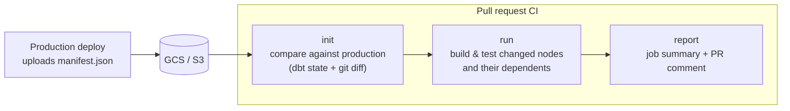

# dbt-ci

[](https://github.com/datablock-dev/dbt-ci/actions/workflows/tests.yml)
[](https://pypi.org/project/dbt-ci/)
[](https://pypi.org/project/dbt-ci/)
[](https://github.com/datablock-dev/dbt-ci/actions/workflows/tests.yml)
[](https://github.com/datablock-dev/dbt-ci/blob/main/LICENSE)

**Slim CI for dbt Core, in your own pipeline.** dbt-ci builds and tests only what a pull
request changes, tells reviewers which dashboards it affects, and cleans up after itself.
It runs in GitHub Actions, GitLab CI or anywhere else Python runs, and it's free and open source.

Every pull request gets a comment like this one, updated on each push:

> ## dbt-ci run report
>
> | Change | Count |
> |---|---:|
> | Modified | 1 |
> | New | 1 |
> | Deleted | 1 |
>
> **Modified (1)**
>
> - `stg_customers` (model)
>
> **New (1)**
>
> - `orders_daily` (model)
>
> **Deleted (1)**
>
> - `legacy_orders` (model)
>
> ### ⚠️ Affects 1 exposure(s)
>
> - `revenue_dashboard`
>
> ### Commands
>
> | Command | Status | Duration |
> |---|---|---:|
> | `init` | ✅ completed | 8.4s |
> | `run` | ✅ completed | 8.9s |

## Quick start

### GitHub Actions

```yaml
name: dbt CI

on:
  pull_request:

permissions:
  contents: read
  pull-requests: write   # for the PR comment

jobs:
  dbt-ci:
    runs-on: ubuntu-latest
    steps:
      - uses: actions/checkout@v7
        with:
          fetch-depth: 0

      # Authenticate to your warehouse and state bucket here

      - uses: datablock-dev/dbt-ci@v1
        with:
          project-dir: dbt
          profiles-dir: dbt
          target: ci
          state-uri: gs://my-bucket/dbt-state/manifest.json   # or s3://
          reference-target: production
          extras: gcp
          adapter: dbt-bigquery
```

That's the whole setup. See the [GitHub Action docs](https://github.com/datablock-dev/dbt-ci/blob/main/docs/github-action.md) for every
input, output and command.

### Any other CI

```bash
pip install 'dbt-ci[gcp]' dbt-bigquery

dbt-ci init --dbt-project-dir dbt --state-uri gs://my-bucket/dbt-state/manifest.json \
  --reference-target production --target ci
dbt-ci run       # build and test the changed nodes and their dependents
dbt-ci report    # summarise the change set (and post it with --pr-comment)
```

There are ready-made [CI/CD examples](https://github.com/datablock-dev/dbt-ci/blob/main/docs/ci-examples.md), including GitLab CI.

## Why dbt-ci?

dbt Core can already select changed models with `--select state:modified+`. dbt-ci builds
on that and handles the parts you would otherwise script yourself:

| | dbt Core alone | dbt-ci |
|---|---|---|
| Build only changed nodes and their dependents | ✅ `state:modified+` | ✅ |
| Fetch the production manifest from GCS or S3 | You script it | ✅ `--state-uri` |
| Ignore changes that only come from environment-specific config | ❌ | ✅ `hybrid` keeps only nodes the git diff also touches |
| Comment the change set and affected exposures on the PR | ❌ | ✅ `report --pr-comment` |
| Post a summary to Slack | ❌ | ✅ |
| Zero-copy PR environment that is torn down afterwards | `dbt clone`, teardown by hand | ✅ `ephemeral create` / `destroy` |
| Drop tables of models deleted in the PR | ❌ | ✅ `delete` |
| Rebuild tables whose partitioning changed | ❌ | ✅ `migration` |

On dbt Cloud, its CI jobs already run `state:modified+` with deferral. dbt-ci is for
teams that run dbt Core in their own CI. It decides *what* to build; data-diff tools such
as Datafold or Recce compare the data that was built, and work alongside it.

## How it works



1. **`init`** downloads the production manifest, compares it with the pull request, and
   caches the change set: modified, new and deleted nodes.
2. **`run`**, **`ephemeral`**, **`delete`** and **`migration`** read that cache, so the
   state is resolved once per CI run.
3. **`report`** renders the change set, the exposures it affects and the status of each
   command, then **`finalize`** uploads the artifacts and clears the cache.

## Commands

| Command | What it does |
|---------|--------------|
| [`init`](https://github.com/datablock-dev/dbt-ci/blob/main/docs/commands.md#init---initialize-state) | Compare the PR against the production state and cache the change set |
| [`run`](https://github.com/datablock-dev/dbt-ci/blob/main/docs/commands.md#run---run-modified-models) | Build and test the changed nodes, optionally capped with `--downstream-depth` |
| [`ephemeral`](https://github.com/datablock-dev/dbt-ci/blob/main/docs/commands.md#ephemeral---ephemeral-environment) | Clone what the PR needs into an isolated schema, and tear it down afterwards |
| [`delete`](https://github.com/datablock-dev/dbt-ci/blob/main/docs/commands.md#delete---delete-removed-models) | Drop the tables of models the PR removed |
| [`migration`](https://github.com/datablock-dev/dbt-ci/blob/main/docs/commands.md#migration---migrate-partitioning-changes) | Rebuild tables whose partitioning configuration changed |
| [`report`](https://github.com/datablock-dev/dbt-ci/blob/main/docs/commands.md#report---summarise-the-run) | Write the run report to the job summary, a file or a PR comment |
| [`finalize`](https://github.com/datablock-dev/dbt-ci/blob/main/docs/commands.md#finalize---finalize-state) | Upload artifacts to GCS or S3 and clear the cache |
| [`config`](https://github.com/datablock-dev/dbt-ci/blob/main/docs/commands.md#config---generate-a-config-file) | Generate a commented `dbt-ci.config.yaml` |

## Compatibility

| | Supported |
|---|---|
| dbt | dbt-core 1.10, 1.11 and 1.12, and [dbt v2](https://github.com/datablock-dev/dbt-ci/blob/main/docs/configuration.md#dbt-v2) |
| Python | 3.12, 3.13, 3.14 |
| Warehouses | Any dbt adapter for `init`, `run`, `report` and `ephemeral create`. BigQuery for `delete`, `migration` and `ephemeral destroy` |
| State storage | GCS, S3 or a local path |
| How dbt runs | In-process, a local binary, Docker or a shell script ([runners](https://github.com/datablock-dev/dbt-ci/blob/main/docs/runners.md)) |

## Documentation

- [GitHub Action](https://github.com/datablock-dev/dbt-ci/blob/main/docs/github-action.md): inputs, outputs and command lists
- [Installation](https://github.com/datablock-dev/dbt-ci/blob/main/docs/installation.md): extras, supported versions, development install
- [Commands](https://github.com/datablock-dev/dbt-ci/blob/main/docs/commands.md): every command and its flags
- [Configuration](https://github.com/datablock-dev/dbt-ci/blob/main/docs/configuration.md): `dbt-ci.config.yaml`, common flags, environment variables, cache
- [Runners](https://github.com/datablock-dev/dbt-ci/blob/main/docs/runners.md): in-process, local, Docker and bash
- [State storage](https://github.com/datablock-dev/dbt-ci/blob/main/docs/state-storage.md): keeping the production manifest in GCS or S3
- [CI/CD examples](https://github.com/datablock-dev/dbt-ci/blob/main/docs/ci-examples.md): GitHub Actions without the action, GitLab CI, common workflows

## Contributing

Contributions are welcome. See [CONTRIBUTING.md](https://github.com/datablock-dev/dbt-ci/blob/main/CONTRIBUTING.md) for the development
setup, and [RELEASING.md](https://github.com/datablock-dev/dbt-ci/blob/main/RELEASING.md) for how releases are published.
Questions and ideas go to [GitHub Issues](https://github.com/datablock-dev/dbt-ci/issues).

## License

[MIT](https://github.com/datablock-dev/dbt-ci/blob/main/LICENSE)
